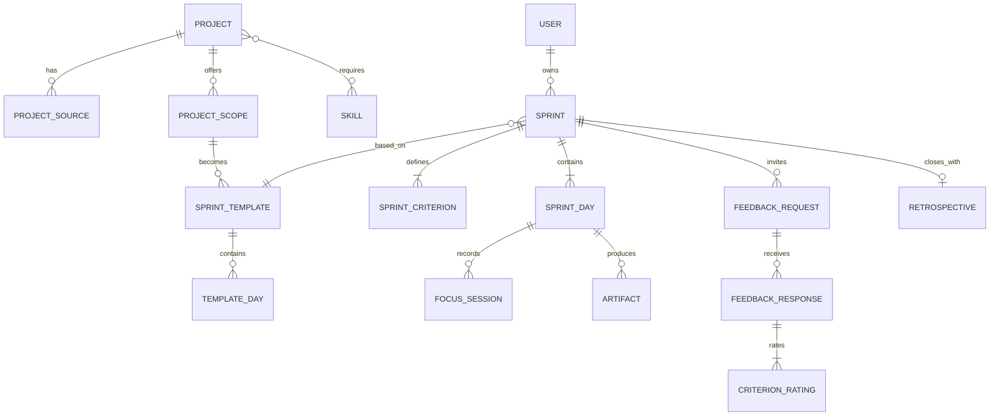

# In2Weeks V2 产品与技术方案

> 状态：可进入需求拆分与开发  
> 目标：把当前单用户原型升级为可上线、可验证核心商业假设的多用户产品  
> 核心原则：不做课程消费平台，做“14 天成果交付操作系统”

## 1. 决策摘要

In2Weeks V2 继续保留自己的产品内核，不直接 Fork 任一大型开源项目。

| 参考项目 | 借鉴能力 | 不照搬的部分 |
| --- | --- | --- |
| [roadmap.sh](https://github.com/kamranahmedse/developer-roadmap) | 项目内容模型、难度标签、技能关联、社区维护方式 | 无限延伸的长期学习路线 |
| [Super Productivity](https://github.com/super-productivity/super-productivity) | 今日工作台、时间盒、实际用时、收工总结、本地即时反馈 | 通用 Todo 和复杂第三方任务同步 |
| [Frappe Learning](https://github.com/frappe/lms) | 角色权限、模板管理、提交与评审、教练后台 | 课程—章节—课时的内容消费模型 |
| [Formbricks](https://github.com/formbricks/formbricks) | 无登录反馈链接、量表、反馈收集与聚合 | 通用问卷编辑器和企业调研功能 |
| [Plane](https://github.com/makeplane/plane) | Cycle、里程碑、状态和活动记录 | 团队项目管理、Issue 管理和看板大全 |
| [Project Based Learning](https://github.com/practical-tutorials/project-based-learning) | 第二项目来源、按语言整理的项目教程 | 原始链接列表式展示 |

V2 采用模块化单体，而不是微服务。前后端统一使用 TypeScript，核心数据进入 PostgreSQL；文件进入对象存储；提醒和内容同步通过后台任务处理。这样既能支持多用户，又不会过早引入分布式复杂度。

## 2. 产品定位与边界

### 2.1 一句话定位

帮助用户在 14 天内，通过“先做、补缺、反馈、重建”，交付一个可验证的真实作品。

### 2.2 核心用户

**首要用户：有基础但迟迟没有作品的人**

- 知道自己感兴趣的方向；
- 收藏过很多教程；
- 每天可以投入 60—120 分钟；
- 需要明确边界、外部截止日期和反馈。

**次要用户：教练、教师或小团队负责人**

- 希望给一组人发起同一项目挑战；
- 需要模板、提交记录和轻量评审；
- 不需要完整 LMS。

**外部评审者**

- 通过分享链接查看作品；
- 无需注册即可按标准反馈；
- 不参与日常学习过程。

### 2.3 明确不做

- 不做长视频托管与完整课程售卖；
- 不做通用习惯追踪器或 Todo 应用；
- 不做无限滚动的信息流；
- 不以连续签到代替作品进展；
- 不让 AI 代替用户完成项目；
- MVP 不做复杂组织、计费和证书体系。

## 3. 成功指标

### 3.1 北极星指标

**合格冲刺交付率**

```text
14 天内提交最终作品
+ 至少上传一个可访问的成果证据
+ 至少一条验收标准被验证
+ 完成最终复盘
```

### 3.2 核心漏斗

| 阶段 | 指标 |
| --- | --- |
| 发现价值 | 项目详情 → 开始制定成果合同 |
| 建立承诺 | 合同创建完成率 |
| 快速行动 | 创建后 24 小时内完成首次记录 |
| 跑通闭环 | 第 3 天粗糙版本提交率 |
| 获得反馈 | 第 7 天外部反馈邀请率、反馈返回率 |
| 形成能力 | 第 9 天独立重建完成率 |
| 正式交付 | 第 14 天最终作品提交率 |

课程观看时间、页面停留时间和收藏数量不作为成功指标。

## 4. 产品核心闭环

```text
发现项目
  ↓
定义具体成果与验收标准
  ↓
系统生成 14 天基础路线
  ↓
今天先闭卷尝试
  ↓
记录障碍 → 只补当前知识
  ↓
上传作品证据并收工
  ↓
第 7 天邀请真实评审
  ↓
根据反馈重建、迁移、限时完成
  ↓
第 14 天发布作品并复盘
  ↺
从复盘推荐下一次更高难度冲刺
```

与常规 LMS 的区别在于：内容不是流程中心，作品状态变化才是流程中心。

## 5. 功能范围

### 5.1 P0：首次上线必须具备

1. 邮箱或 GitHub 登录；
2. 项目库搜索、分类、语言和难度筛选；
3. 项目详情与“缩小到 14 天”的建议；
4. 成果合同创建；
5. 自动生成 14 天计划；
6. 今日工作台与专注计时；
7. 每日完成物、障碍、用时和主动回忆；
8. 文件、链接、GitHub 仓库和文字四类作品证据；
9. 第 7/12/14 天无登录评审链接；
10. 反馈按验收标准聚合；
11. 第 14 天作品展示和复盘；
12. 个人历史冲刺与作品页。

### 5.2 P1：验证核心闭环后增加

- 项目模板编辑与教练后台；
- 一组用户参加同一挑战；
- 邮件、浏览器和日历提醒；
- GitHub 仓库提交活动同步；
- 项目链接失效检查；
- 可复制的公开冲刺模板；
- 个人周报和冲刺分享卡片。

### 5.3 P2：有足够真实数据后再做

- AI 障碍诊断与苏格拉底式提问；
- 根据历史表现动态调整每日任务；
- 同项目学习伙伴匹配；
- 作品社区与公开评审；
- 付费教练和团队空间。

## 6. 信息架构

### 6.1 公共区域

| 路由 | 页面目的 |
| --- | --- |
| `/` | 解释价值，展示真实作品和 14 天机制 |
| `/explore` | 搜索项目和冲刺模板 |
| `/projects/[slug]` | 项目要求、推荐范围、技能和来源 |
| `/works/[slug]` | 用户最终作品公开页 |
| `/review/[token]` | 无需登录的外部评审页 |
| `/method` | 解释成果驱动方法 |

### 6.2 登录后区域

| 路由 | 页面目的 |
| --- | --- |
| `/today` | 当前唯一任务、计时、障碍和收工 |
| `/sprints/new` | 五步成果合同向导 |
| `/sprints/[id]` | 14 天总览、合同和指标 |
| `/sprints/[id]/days/[day]` | 某天任务与证据详情 |
| `/sprints/[id]/feedback` | 邀请评审与反馈聚合 |
| `/sprints/[id]/retrospective` | 第 14 天验收与复盘 |
| `/library` | 历史冲刺、作品和学会的技术 |
| `/settings` | 账户、提醒、隐私与数据导出 |

### 6.3 教练区域（P1）

| 路由 | 页面目的 |
| --- | --- |
| `/coach/templates` | 创建和维护冲刺模板 |
| `/coach/cohorts` | 发起小组挑战 |
| `/coach/cohorts/[id]` | 查看成员交付状态和待评审项 |

## 7. 关键页面设计

### 7.1 项目详情页

项目详情不是教程介绍页，而是“是否适合下一次 14 天冲刺”的决策页。

```text
┌─────────────────────────────────────────────────┐
│ Build a Redis                          中级 · Go │
│ 两周版本：支持 SET / GET / DEL 的单机内存存储   │
│                                                 │
│ [以此开始冲刺]             [查看原教程 ↗]       │
├───────────────────────┬─────────────────────────┤
│ 最终交付物            │ 需要的 A 类技术         │
│ · 可运行程序          │ · TCP Socket            │
│ · 10 个测试           │ · RESP 最小子集         │
│ · 3 分钟演示          │ · 内存键值结构           │
├───────────────────────┴─────────────────────────┤
│ 不在本次范围：持久化、集群、完整兼容……           │
└─────────────────────────────────────────────────┘
```

关键设计：

- 默认给出一个“最小可交付范围”；
- 明确展示“不在本次范围”；
- 显示预计每日投入、基础要求和验证方式；
- 原教程是资源，不是必须按顺序消费的课程。

### 7.2 成果合同向导

拆成五步，避免一次填写长表单：

1. **作品**：第 14 天实际能打开、运行或演示什么；
2. **使用者**：谁会使用或评审；
3. **标准**：最多三条可观察标准；
4. **限制**：每日时间、已有能力、不做什么；
5. **承诺**：选择第 7 天和第 14 天评审方式。

系统必须在创建前进行范围提示：

- 目标使用“掌握、了解、提高”等不可观察词时要求改写；
- 三项以上大型子系统时提示缩小；
- 每日时间不足时建议删减验收标准；
- 用户可以接受建议，也可以保留原目标。

### 7.3 今日工作台

借鉴 Super Productivity 的时间盒，但只保留与作品有关的动作。

```text
┌──────────────────────────────────┬───────────────┐
│ DAY 04 / 修复最大瓶颈            │ 成果合同      │
│                                  │ 完成率 21%    │
│ 今天唯一推进：实现 RESP 解码     │ 连续推进 3 天 │
│                                  │               │
│ 15m 闭卷尝试                     │ 今日证据      │
│ 25m 定向补缺                     │ 一个失败测试  │
│ 50m 立即应用                     │ 变为通过      │
│                                  │               │
│ [开始 90 分钟专注]               │ [查看全计划]  │
├──────────────────────────────────┴───────────────┤
│ 遇到什么障碍？  [快速记录，不离开当前工作区]     │
└──────────────────────────────────────────────────┘
```

规则：

- 默认不展示未来大量任务；
- 计时器可以暂停，但不以番茄数量评分；
- 搜索和 AI 入口必须从“当前障碍”启动；
- 当日完成必须附带一个证据或明确说明为什么没有证据。

### 7.4 每日收工

收工表单控制在两分钟以内：

- 实际制作时间；
- 今日完成物；
- 最大障碍；
- 不看资料，写下今天学会的技术；
- 明日第一步。

保存后展示的是“作品发生了什么变化”，不是夸张的签到动画。

### 7.5 外部评审

评审者无需注册，只看到：

- 成果合同；
- 当前作品链接或文件；
- 每条验收标准的“达到 / 部分达到 / 未达到”；
- 最大缺陷；
- 如果只能改一次，最该改什么；
- 可选署名。

提交后链接进入只读状态；创建者可以生成新一轮评审，而不是覆盖旧反馈。

### 7.6 最终复盘

第 14 天不以“14 个格子全部点亮”作为完成条件，而是回答：

- 最终作品在哪里；
- 三条标准分别有什么证据；
- 哪项技术可以脱离教程独立复现；
- 哪项技术可以迁移；
- 最大失败是什么；
- 下一次冲刺是增加难度、迁移情境，还是先修复基础。

## 8. 内容与项目模型

项目库由三层组成：

```text
Project（项目概念）
├── ProjectSource（外部教程来源）
├── ProjectScope（可在 14 天交付的范围版本）
├── Skill（需要组合的技术）
└── SprintTemplate（可执行的 14 天模板）
```

例如 “Redis” 是一个 Project；C++、Go、Python 教程分别是 ProjectSource；“只实现 SET/GET/DEL”是一个 ProjectScope；Socket、协议解析、键值结构是 Skill；每日任务和证据要求构成 SprintTemplate。

### 8.1 内容进入流程

1. 定时拉取本地或远程 Markdown；
2. 解析标题、URL、语言、分类和格式；
3. 以规范化 URL 去重；
4. 记录来源仓库和内容哈希；
5. 检查链接状态；
6. 新内容进入待审核区；
7. 运营人员补充 14 天范围、难度和技能；
8. 审核后发布。

MVP 使用 PostgreSQL 全文搜索；项目规模和中文搜索需求明显增长后，再评估 Meilisearch 或 Typesense。

## 9. 数据模型

### 9.1 核心关系



### 9.2 主要实体

#### User

| 字段 | 类型 | 说明 |
| --- | --- | --- |
| `id` | UUID | 主键 |
| `email` | citext | 唯一邮箱 |
| `name` | text | 展示名 |
| `imageUrl` | text | 头像 |
| `timezone` | text | 生成“今日”和提醒 |
| `role` | enum | learner / coach / admin |
| `createdAt` | timestamptz | 创建时间 |

#### Project

| 字段 | 类型 | 说明 |
| --- | --- | --- |
| `id` | UUID | 主键 |
| `slug` | text | 稳定公开地址 |
| `title` | text | 项目名称 |
| `summary` | text | 项目简介 |
| `category` | text | 分类 |
| `difficulty` | enum | beginner / intermediate / advanced |
| `status` | enum | draft / published / archived |

#### Sprint

| 字段 | 类型 | 说明 |
| --- | --- | --- |
| `id` | UUID | 主键 |
| `userId` | UUID | 所有者 |
| `templateId` | UUID? | 可为空，自定义冲刺 |
| `title` | text | 最终作品 |
| `audience` | text | 使用者或评审者 |
| `dailyMinutes` | int | 30—240 |
| `startDate` | date | 按用户时区 |
| `status` | enum | draft / active / paused / completed / abandoned |
| `visibility` | enum | private / unlisted / public |
| `currentDay` | smallint | 1—14 |

#### SprintDay

| 字段 | 类型 | 说明 |
| --- | --- | --- |
| `id` | UUID | 主键 |
| `sprintId` | UUID | 所属冲刺 |
| `dayNumber` | smallint | 唯一约束：同冲刺 1—14 |
| `theme` | text | 当日主题 |
| `task` | text | 唯一主任务 |
| `evidenceRequirement` | text | 必须留下的证据 |
| `level` | enum | L1—L5 |
| `status` | enum | locked / available / completed / skipped |
| `artifactSummary` | text | 今日完成物说明 |
| `obstacle` | text | 最大障碍 |
| `recall` | text | 主动回忆 |
| `nextAction` | text | 明日第一步 |
| `completedAt` | timestamptz? | 完成时间 |

#### Artifact

| 字段 | 类型 | 说明 |
| --- | --- | --- |
| `id` | UUID | 主键 |
| `sprintId` | UUID | 所属冲刺 |
| `sprintDayId` | UUID? | 可关联某天 |
| `kind` | enum | file / link / github / text / image |
| `title` | text | 证据名称 |
| `url` | text? | 外部或对象存储地址 |
| `metadata` | jsonb | MIME、仓库、commit SHA 等 |

#### FeedbackRequest

| 字段 | 类型 | 说明 |
| --- | --- | --- |
| `id` | UUID | 主键 |
| `sprintId` | UUID | 所属冲刺 |
| `tokenHash` | text | 只存分享 Token 哈希 |
| `round` | smallint | 1、2 或 final |
| `expiresAt` | timestamptz? | 可选过期时间 |
| `maxResponses` | int | 防止公开链接滥用 |
| `status` | enum | open / closed / expired |

所有用户数据表必须包含所有者路径，查询必须在服务端进行授权，不接受客户端传入的 `userId` 作为可信边界。

## 10. 系统架构

### 10.1 推荐技术栈

| 层 | 选择 | 原因 |
| --- | --- | --- |
| Web | Next.js App Router + TypeScript | 服务端渲染、路由、API 和部署生态统一 |
| UI | CSS Variables + Tailwind + Radix Primitives | 保留现有视觉语言并获得可访问交互组件 |
| 表单 | React Hook Form + Zod | 合同与评审需要严格结构化校验 |
| 数据库 | PostgreSQL | 关系、JSON、全文检索和事务足够覆盖 MVP |
| ORM | Drizzle 或 Prisma，项目开始时二选一 | 类型安全迁移；避免同时使用 |
| 认证 | Auth.js | 邮箱和 GitHub OAuth |
| 文件 | S3 兼容对象存储 | 作品文件、图片和导出 |
| 邮件 | Resend 或兼容 SMTP | 第 7/14 天邀请与提醒 |
| 后台任务 | 数据库任务表起步，必要时 BullMQ | MVP 不强制引入 Redis |
| 监控 | OpenTelemetry + Sentry | 错误、性能和任务可观测 |
| 产品分析 | PostHog（可自托管） | 漏斗和事件分析 |
| 测试 | Vitest + Playwright | 领域逻辑、API 和核心用户流程 |

### 10.2 模块边界

```text
apps/web
├── modules/auth
├── modules/catalog
├── modules/sprints
├── modules/focus
├── modules/artifacts
├── modules/feedback
├── modules/retrospectives
├── modules/notifications
└── modules/analytics

packages
├── db
├── contracts
├── content-ingestion
├── ui
└── config
```

模块只能通过公开 service 接口调用其他模块，页面不能直接拼装跨模块数据库查询。先保持一个部署单元；只有内容同步或通知任务出现独立扩缩容需要时，才拆 Worker。

### 10.3 请求链路

```text
浏览器
  ↓ HTTPS
Next.js Web / Route Handlers
  ├── Auth.js：身份
  ├── Zod：输入校验
  ├── Domain Service：规则
  ├── PostgreSQL：结构化数据
  ├── Object Storage：作品文件
  └── Job Table / Worker：邮件、同步、链接检查
```

## 11. API 设计

内部 Web 优先使用类型安全的 Server Actions；公开、分享和未来移动端能力使用版本化 REST API。

### 11.1 核心接口

| 方法 | 路径 | 用途 |
| --- | --- | --- |
| `GET` | `/api/v1/projects` | 搜索项目 |
| `GET` | `/api/v1/projects/:slug` | 项目、范围和来源 |
| `POST` | `/api/v1/sprints` | 创建成果合同 |
| `GET` | `/api/v1/sprints/:id` | 获取冲刺详情 |
| `PATCH` | `/api/v1/sprints/:id` | 暂停、恢复、修改可见性 |
| `GET` | `/api/v1/sprints/:id/today` | 按时区获取今日任务 |
| `PATCH` | `/api/v1/sprint-days/:id` | 保存障碍、回忆和明日动作 |
| `POST` | `/api/v1/sprint-days/:id/complete` | 校验证据并完成当天 |
| `POST` | `/api/v1/focus-sessions` | 开始专注 |
| `PATCH` | `/api/v1/focus-sessions/:id` | 暂停或结束 |
| `POST` | `/api/v1/artifacts` | 创建文件上传或外部证据 |
| `POST` | `/api/v1/sprints/:id/feedback-requests` | 创建评审链接 |
| `GET` | `/api/v1/reviews/:token` | 获取公开评审内容 |
| `POST` | `/api/v1/reviews/:token/responses` | 提交评审 |
| `POST` | `/api/v1/sprints/:id/retrospective` | 最终验收和复盘 |

### 11.2 创建冲刺示例

```json
{
  "projectScopeId": "scope_redis_minimal",
  "title": "一个支持 SET、GET、DEL 的迷你 Redis",
  "audience": "两位后端开发者",
  "dailyMinutes": 90,
  "startDate": "2026-08-03",
  "criteria": [
    { "text": "通过 10 个协议测试", "verification": "test" },
    { "text": "支持两个客户端依次连接", "verification": "demo" },
    { "text": "能在 3 分钟内解释核心实现", "verification": "review" }
  ],
  "excludedScope": ["持久化", "集群", "完整 Redis 协议兼容"]
}
```

### 11.3 统一错误结构

```json
{
  "error": {
    "code": "SPRINT_SCOPE_TOO_LARGE",
    "message": "当前范围可能无法在每日 90 分钟内完成",
    "fields": {
      "criteria": "建议最多保留三条验收标准"
    },
    "requestId": "req_..."
  }
}
```

## 12. 关键领域规则

1. 一个用户同一时间默认只能有一个 `active` 冲刺；
2. 冲刺固定 14 个计划日，但允许暂停，暂停不伪造连续记录；
3. 完成当天至少需要文字证据或 Artifact；
4. 制作时间和学习输入时间分开记录；
5. 第 7、12、14 天计划必须包含外部反馈或明确的自评替代说明；
6. 用户可以提前查看未来计划，但默认只突出今天；
7. 删除冲刺采用 30 天软删除，作品公开链接立即失效；
8. 分享 Token 只展示必要内容，不能反查用户私人记录；
9. AI 输出只能建议、诊断和提问，不能自动把某天标记为完成；
10. 所有时间判断使用用户时区，数据库统一存 UTC。

## 13. 通知策略

通知服务于交付，不制造焦虑：

- 用户选择的每日开始提醒；
- 当天结束前仍无作品变化时提醒一次；
- 第 7/12/14 天评审提醒；
- 外部反馈返回通知；
- 连续两天没有活动时提供“缩小范围或暂停”，不发送羞辱性文案。

默认每类通知可关闭；营销邮件与产品提醒分开授权。

## 14. 安全、隐私与许可证

### 14.1 安全基线

- Session 使用安全、HttpOnly、SameSite Cookie；
- 所有修改操作校验身份和资源所有权；
- 公开评审接口按 IP、Token 和 Sprint 限流；
- 文件上传采用预签名 URL、类型白名单、大小限制和恶意文件扫描；
- 外部 URL 展示前进行协议白名单处理；
- Markdown 渲染必须净化 HTML；
- Token、OAuth Secret 和邮件密钥进入 Secret Manager；
- 操作日志记录公开状态变化、评审链接创建和数据导出；
- 每日数据库备份并定期验证恢复。

### 14.2 隐私

- 默认冲刺和作品均为私有；
- 分享页明确列出将被公开的内容；
- 支持账户数据导出和删除；
- 产品分析不采集作品正文、障碍文本和评审内容；
- AI 能力上线前必须单独说明哪些内容发送给模型服务。

### 14.3 开源许可证

- Super Productivity 的 MIT 代码可以在遵守声明要求后参考或复用；
- Frappe Learning、Open edX、Formbricks、Plane 等包含 AGPL 或 Open Core 边界；
- 不直接复制其实现，除非确认整个产品的开源策略与许可证兼容；
- 项目教程保留原作者、原仓库和许可证信息；
- `build-your-own-x` 与其他来源的内容同步只存必要元数据和链接，不重新发布受限全文。

## 15. 分阶段实施

### Phase 0：冻结原型基线（1—2 天）

- 保留当前无依赖版本作为交互原型；
- 将当前 API、页面和 14 天模板变成验收样例；
- 补充核心流程截图或录屏；
- 不再向 JSON 单用户架构增加复杂功能。

**退出条件**：产品流程和 V2 设计评审通过。

### Phase 1：生产基础（1—2 周）

- 初始化 Next.js TypeScript 工作区；
- PostgreSQL、迁移、种子数据；
- Auth.js 邮箱/GitHub 登录；
- 项目导入和搜索；
- 统一 UI Token 与响应式布局；
- CI、单元测试、预览部署。

**退出条件**：用户可登录、浏览项目，内容导入可重复执行。

### Phase 2：14 天核心闭环（2—3 周）

- 成果合同向导与范围检查；
- Sprint、Criterion、SprintDay 数据模型；
- 今日工作台和计时；
- 每日收工与作品证据；
- 历史冲刺和作品库；
- 时区、暂停和恢复。

**退出条件**：一个用户能从创建合同走到第 14 天复盘，数据不依赖管理员手工修改。

### Phase 3：真实反馈（1—2 周）

- 无登录评审链接；
- 按验收标准评分；
- 反馈聚合；
- 第 7/12/14 天邀请；
- 邮件通知、限流和滥用防护；
- 最终作品公开页。

**退出条件**：评审者无需注册即可完成反馈，创建者能把反馈转成下一步修复。

### Phase 4：内容运营与教练（2 周）

- 项目范围与模板后台；
- 内容审核、版本和失效链接检查；
- 教练模板；
- 小组挑战最小版本；
- 核心漏斗分析面板。

**退出条件**：非开发人员可以增加一个项目模板并发起挑战。

## 16. 测试策略

### 单元测试

- 14 天模板生成；
- 范围提示规则；
- 时区和暂停后的当前日计算；
- 连续行动计算；
- Token 哈希和过期；
- 项目解析与去重。

### 集成测试

- 创建 Sprint 的事务完整性；
- 完成一天时 Artifact 约束；
- 私有资源授权；
- 评审 Token 限制；
- 文件元数据和对象存储回调。

### 端到端测试

1. 新用户从 Redis 项目创建冲刺；
2. 完成第 1 天并上传链接证据；
3. 暂停并恢复；
4. 第 7 天生成评审链接；
5. 匿名评审者提交反馈；
6. 用户查看反馈并完成最终复盘；
7. 将作品设为公开。

无障碍测试覆盖键盘导航、Dialog 焦点、颜色对比、表单错误朗读和移动端触控区域。

## 17. 上线验收标准

- 新用户在 5 分钟内能够创建合格成果合同；
- 项目搜索 P95 小于 500ms；
- 今日页核心内容在移动网络下优先渲染；
- 所有用户数据查询通过服务端所有权测试；
- 文件和公开评审接口通过基础滥用测试；
- 核心七步端到端流程在 CI 中稳定通过；
- 可以导出或删除用户数据；
- 发生邮件、同步或分析故障时，不影响每日记录和作品提交；
- 首批测试用户可以完成一次完整 14 天冲刺，无需开发者直接改数据库。

## 18. 下一步执行顺序

1. 用 5 名目标用户验证成果合同向导和今日工作台；
2. 确认 ORM、认证方式、部署平台和对象存储；
3. 将本方案拆成 Phase 1 的 Epic 和验收任务；
4. 先实现数据模型与项目导入，再迁移视觉页面；
5. 第一次上线只开放 P0，真实观察第 3、7、14 天流失点；
6. 有完整冲刺数据后，再决定 AI 教练和社区功能。

